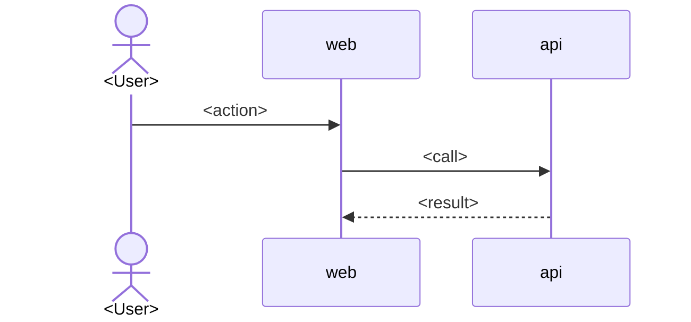
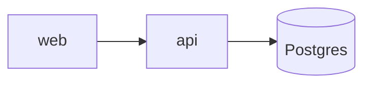

# <NNN> — <Feature name> · Feature Review

> Generated <YYYY-MM-DD> from plan status `<status>` — **snapshot**; the plan files remain the source of truth.
> Plan: [<folder>](./README.md) · CRs included: <CR-1, CR-2 | none> · Audience: <plain | dev | both>
> Sources read: <bu/po/stk/dev/qa/ops.md · CR-*.md · docs/openapi.yaml · context/DEV.md §7 · plans/README.md · PLAN.md>

## 1. สรุปสั้น (TL;DR)

<≤5 บรรทัด ภาษาคน: ทำไปเพื่ออะไร · ใครได้ประโยชน์ · เปลี่ยนอะไรกับระบบ · สถานะตอนนี้ · verdict ข้อ 8>

| | |
|---|---|
| สถานะ | `<status>` (ถัดไป: `<next status>`) |
| เจ้าของ / Roles | <PO · DEV · QA · OPS> |
| ขึ้นกับ plan | <017, 028, …> |
| Verdict | <🟢 พร้อม · 🟡 พร้อมแบบมีเงื่อนไข · 🔴 ยังไม่พร้อม> — <เหตุผลหนึ่งบรรทัด> |

---

# ส่วน A — มุม Requirement (ธุรกิจ / ผลิตภัณฑ์)

## 2. เป้าหมายและปัญหา
- **ปัญหาเดิม:** <…>
- **เป้าหมาย:** <…>
- **ใครใช้ / ใครได้ผลกระทบ:** <persona / role> *(source: bu.md §1)*

## 3. การตัดสินใจสำคัญ (Decisions)
| # | ตัดสินใจอะไร (ภาษาคน) | เพราะอะไร | ทางเลือกที่ปัดทิ้ง |
|---|---|---|---|
| D1 | <…> | <…> | <…> |

## 4. ขอบเขต
- **อยู่ในขอบเขต:** <…>
- **นอกขอบเขต:** <…>

## 5. เรื่องราวของผู้ใช้ → เงื่อนไขผ่าน → เทสต์ (Traceability)
| User Story | พูดเป็นภาษาคน | AC | Test Case | Priority | Status |
|---|---|---|---|---|---|
| US-01 | <…> | AC-01 | TC-01, TC-02 | High | to do |

> AC ที่ยังไม่มี TC: <none | AC-xx> · US ที่ยังไม่มี AC: <none | US-xx>

## 6. Flow การใช้งานหลัก (ถ้ามี)

---

# ส่วน B — มุม Technical

## 7. สถาปัตยกรรม (Architecture)
- **Service ที่แตะ:** <api · web · …> · **ไม่แตะ:** <…>
- **ส่วนประกอบใหม่/ที่แก้:** <module / service / policy / job> — <หน้าที่ 1 บรรทัด>
- **จุดตัดสินสิทธิ์ (authz boundary):** <ใครตรวจที่ไหน — เช่น policy service กลาง, guard, menu gate> *(dev.md §5)*
- **ความสอดคล้องของข้อมูล:** <transaction / lock / idempotency / eventual consistency>
- **ผลกระทบต่อของเดิม:** <consumer / route / dashboard ที่ต้องไม่เปลี่ยน หรือต้องแก้ตาม>
- **Dependency / Tech ใหม่:** <none | …>

### 7.1 Diagram (ถ้าโครงสร้างซับซ้อน)

## 8. ฐานข้อมูล (DB / Data Model)
| Entity | เปลี่ยนอะไร | ทำไป เพื่ออะไร | Constraint / Index |
|---|---|---|---|
| `<table>` | add `<col>` (<type>, nullable?) | <purpose> | <FK / unique / check / index> |

- **สถานะ lifecycle ของข้อมูล:** <active → frozen → archived …>
- **Backfill ข้อมูลเดิม:** <…>
- **Migration:** `<file>` — up: <…> · down: <…> · **Rollback หลังมีข้อมูลจริง:** <forward-migration / ไม่ได้>
- **ข้อมูลส่วนบุคคล / audit:** <เก็บอะไร ไม่เก็บอะไร>
- **Sync กับ `context/DEV.md` §7:** <✅ / ⚠️ / ❌>

## 9. API
| Method | URL | ใครเรียกได้ | สำเร็จ | Error ที่ต้องรองรับ | หมายเหตุ |
|---|---|---|---|---|---|
| GET | `/api/<…>` | <role + resource policy> | 200 | 404 / 403 / 423 | <breaking? paging?> |

- **Breaking change:** <none | …> · **Consumer ที่ได้ผล:** <…>
- **Sync กับ `docs/openapi.yaml`:** <✅ / ⚠️ / ❌ + รายการที่ขาด>

## 10. หน้าจอ / Route (UI)
| Route | เปลี่ยน | ใครเข้าได้ | State สำคัญ |
|---|---|---|---|
| `/<…>` | new / modified | <…> | empty · denied · frozen · loading |

## 11. ความปลอดภัยและความเป็นส่วนตัว
| Route / Action | Permission | เหตุผล |
|---|---|---|
| <…> | <…> | <…> |

- **Security review (§8.1):** <ผลจริงของ detector | ยังไม่รัน — เหตุผล | ยอมรับความเสี่ยงโดย <ใคร> เมื่อ <วันที่> — ต้องปิดก่อน `done`>

## 12. Deploy / Ops
- **ลำดับ deploy:** <…> · **Env / secret ใหม่:** <none | …> · **Post-deploy check:** <…>
- **ข้อกำหนด gate:** migration / DB command / commit / push ต้องขออนุมัติแยกครั้ง (CONTEXT.md §11.7)

---

# ส่วน C — คุณภาพและความพร้อม

## 13. แผนทดสอบโดยสรุป
| ชนิด | จำนวน TC | High | Medium | Low | Status |
|---|---|---|---|---|---|
| API | <n> | <n> | <n> | <n> | <to do / …> |
| Web UI | <n> | | | | |

- 4 scenario kinds (Success · Alternative · Edge/Boundary · State/Regression): <ครบ | ขาด …>
- เป้า coverage: **> 80%** · รันด้วย: `<cmd>`

## 14. Cross-check (หลักฐาน)
| # | ตรวจอะไร | ผล | หลักฐาน (file:section) |
|---|---|---|---|
| 1 | ทุก US→AC→TC ครบ | ✅/⚠️/❌/➖ | <…> |
| 2 | Endpoint ใน plan ↔ `docs/openapi.yaml` | | |
| 3 | Entity/column ใน plan ↔ `context/DEV.md` §7 | | |
| 4 | Status ตรงกัน 3 ที่ (plan README · `plans/README.md` · `PLAN.md`) | | |
| 5 | Security matrix ครอบคลุมทุก route ใหม่ + detector state ตรงจริง | | |
| 6 | Plan ที่ depends-on มีอยู่และไม่ block | | |
| 7 | Plan เก่าที่ contract กระทบ ถูกระบุให้ sync | | |
| 8 | Open Questions ไม่ block status ถัดไป | | |

## 15. ความเสี่ยง · ช่องว่าง · คำถามค้าง
| ระดับ | เรื่อง | ผลถ้าไม่แก้ | ใครควรตัดสิน | Block status ไหน |
|---|---|---|---|---|
| 🔴/🟡/🟢 | <…> | <…> | <PO/DEV/OPS> | <ready to implement / done> |

- **ความเสี่ยงที่ยอมรับแล้ว:** <ใคร · เมื่อไหร่ · เงื่อนไขปิด>
- **Open Questions จากแผน:** <ข้อ 1…>

## 16. Change Requests (ถ้ามี `CR-*.md`)
| CR | เปลี่ยนอะไร (delta) | Status | กระทบหัวข้อ |
|---|---|---|---|
| CR-1 | <…> | <…> | <§8 DB, §9 API> |

## 17. Verdict และขั้นต่อไป
- **Verdict:** <🟢/🟡/🔴> — <เหตุผล>
- **ก่อนขยับเป็น `<next status>` ต้องทำ:** <checklist สั้นๆ>
- **งานที่ทำขนานได้ / แยก session ได้:** <…>

<!-- dev|both only -->
## ภาคผนวก — รายละเอียดเทคนิค (audience: dev / both)
- Schema เต็ม (DDL-level), enum/check ทั้งหมด, index rationale
- Request/response shape ราย endpoint, error body, idempotency/paging
- Policy matrix ราย role × state (owner/editor/viewer/unrelated/frozen/superadmin)
- ลำดับ migration/backfill ที่ละเอียดและคำสั่ง verify
